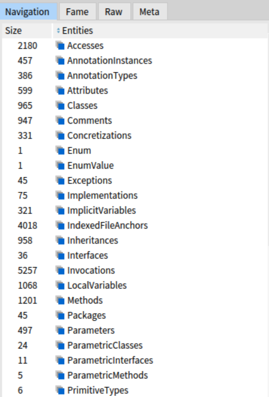
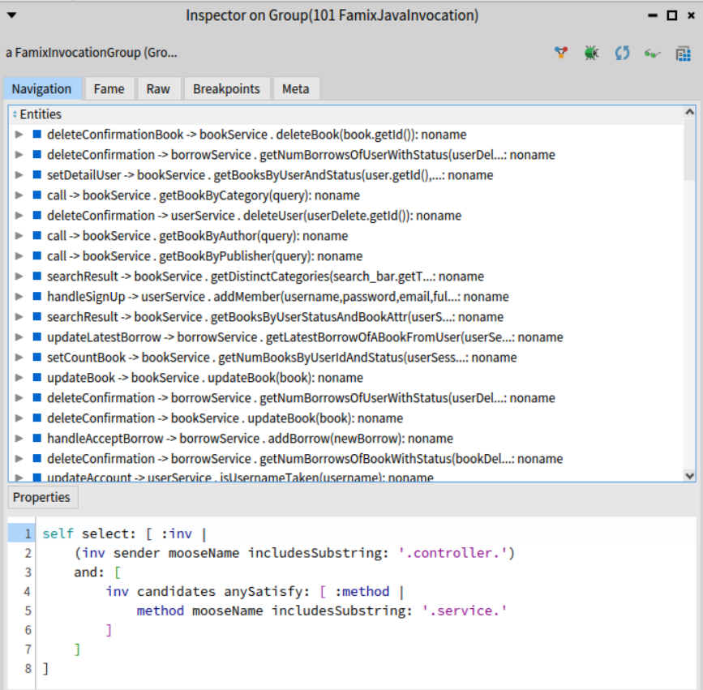
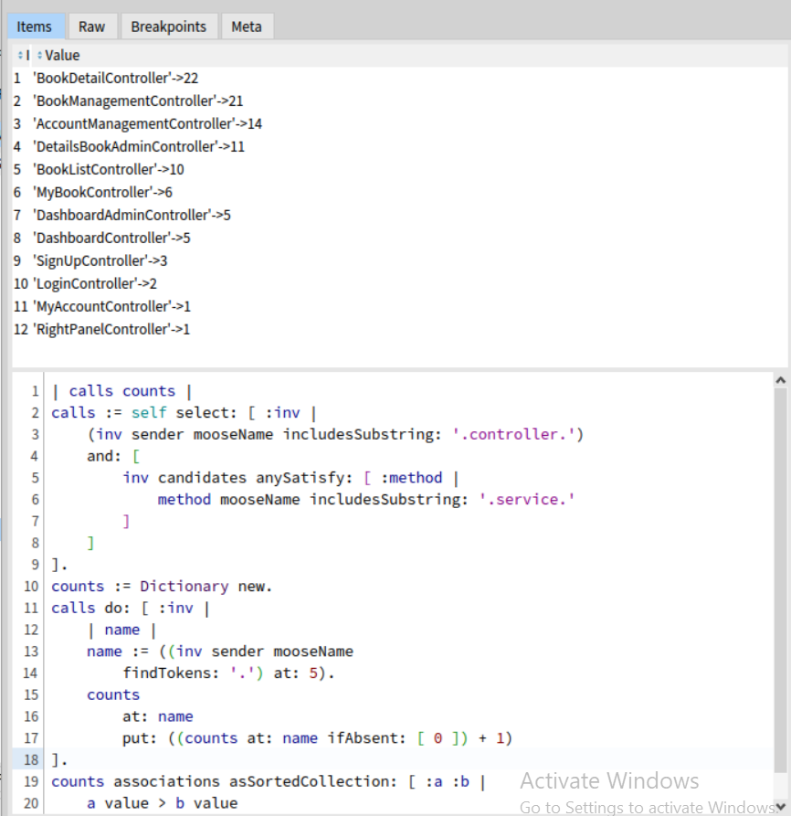
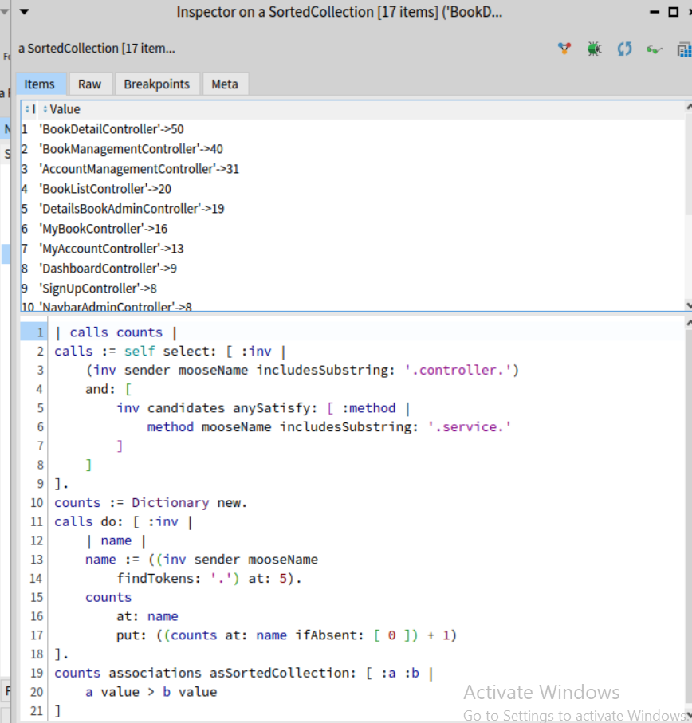
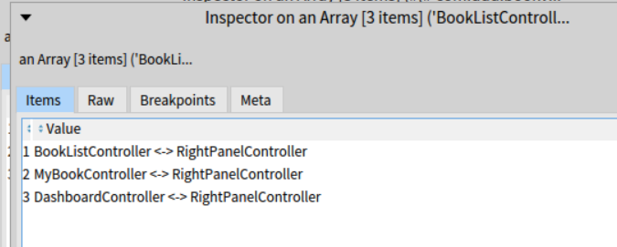
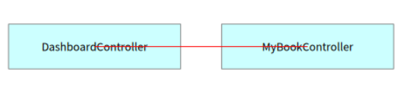
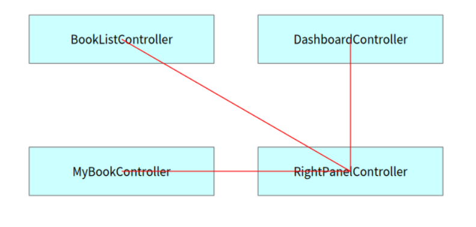
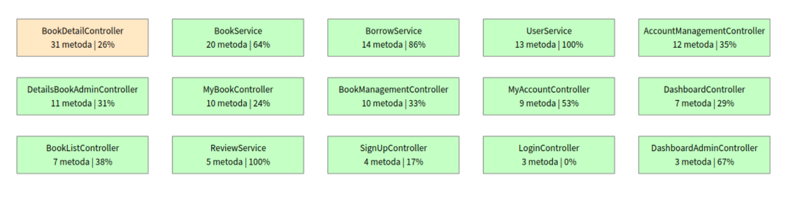
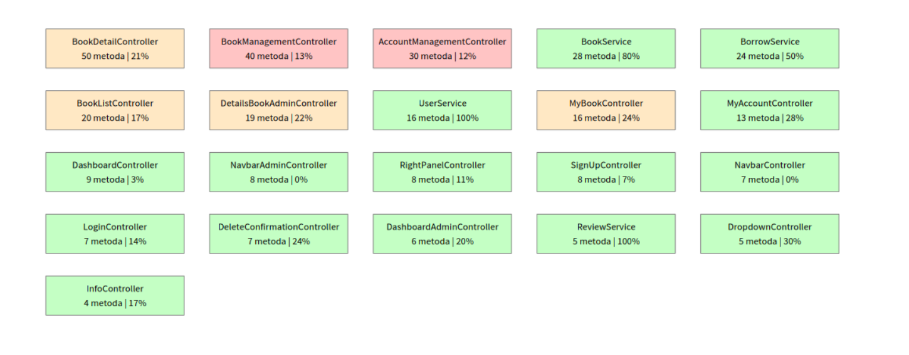
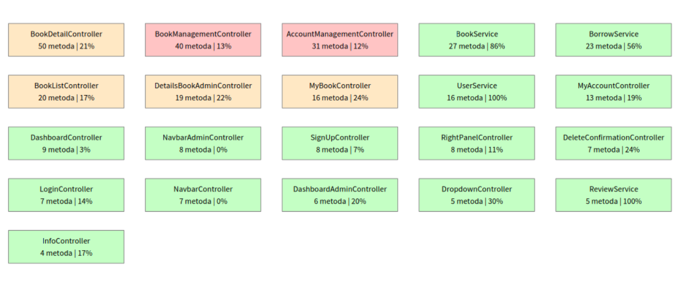

# Analiza softverskog sistema pomoću Moose platforme

Ovaj repozitorijum sadrži projekat analize softverskog sistema korišćenjem platforme Moose i FAMIX metamodela.

Kao studija slučaja odabran je open-source Java projekat za upravljanje bibliotekom (Library Management System - https://github.com/dinhdat07/library_management_system). Kako bi prednosti Moose platforme bili iskorišćeni, izdvojene su tri verzije aplikacije, tj tri git commita (783bdb8, 6fb19cb, d958dd5)

Cilj je istraživanje strukture i zavisnosti softverskog sistema kroz različite nivoe apstrakcije i verzija projekta pomoću Moose platforme i FAMIX modela.

## Alati
- Moose Suite 12 osnova
- VerveineJ 4.2.6 za generisanje FAMIX modela iz izvornog koda
- Pharo/Smalltalk za izvršavanje upita nad FAMIX entitetima

## Učitavanje modela
Uz VerveineJ generisan je JSON model `models/bookverse-model.json`

Filtriranjem klasa prema svojstvu isStub izdvojeno je 67 "ne-stub" klasa uključujući unutrašnje i anonimne klase.

## Zavisnosti arhitekturnih slojeva
Prvi korak - ispitivanje poziva metoda paketa controller -> service -> dao

Primer upita za izdvajanje jednog poziva, izvršeno nad grupom Invocations.

[08 – Arhitekturni slojevi](scripts/08-arhitekturni-slojevi.st)

U ovom momentu analize rezultat je u skladu sa očekivanom organizacijom aplikacije (controller->service->dao), bez direktnih poziva kontrolera ka DAO metodama

## Analiza na nivou klasa i metoda
Ispitano je koje controller klase imaju najviše poziva ka service sloju.

[09 – Kontroleri ka servisima](scripts/09-kontroleri-ka-servisima.st)

`BookDetailController` ostvaruje 22 poziva ka 18 različitih servisnih metoda komunicirajući sa četiri servisne klase.

`BookManagementController` ostvaruje 21 poziv ka servisnim metodama raspoređenim u dve servisne klase.

Dakle, ova dva kontrolera imaju gotovo jednak broj poziva, ali različitu širinu zavisnosti. Broj poziva i broj različitih servisnih klasa predstavljaju različite aspekte povezanosti.

## Ispitivanje veličine kontrolera

U FAMIX modelu identifikovanao je 17 glavnih klasa čija imena sadrže Controller. Za njih je pronađeno ukupno 258 metoda.

[10 – Veličina kontrolera](scripts/10-velicina-kontrolera.st)

Tri najveća kontrolera (BookDetailController, BookManagmentController i AccountManagementController) sadrže ukupno 121 od 258 metoda, odnosno približno 47% metoda svih posmatranih kontrolera. Naravno, još uvek nije dokaz preopterećenosti ili otežane održivosti.

## Međuklasni pozivi i ciklične zavisnosti

Nakon analize slojeva i pojedinačnih kontrolora, istraživanje je prošireno na međuklasne pozive celog sistema. Cilj - utvrditi da li postoje klase koje se međusobno pozivaju, odnosno da li gras poziva metoda sadrži cikluse.

Uz skripte 01 i 02, nad grupom Invocations izdvojeni su jedinstveni usmereni parovi klasa. Pronađeno je 55 klasa u grafu i 161 jedinstvena usmerena međuklasna veza (Jedna veza predstavlja postojanje najmanje jednog poziva metode između dve različite klase).

Skriptom 03 pretraživani su parovi klasa sa dvosmernim pozivima. Pronađena su tri direktna ciklusa:

Sva tri ciklusa uključuju klasu RightPanelController, što je ukazalo na njenu centralnu ulogu u ovoj cikličnoj strukturi.

Uz skriptu 04 identifikovano je devet jedinstvenih parova poziva metoda. 

"Snažno povezane komponente" predstavljaju grupu klasa u kojima postoji usmerena putana između svih klasa međusobno. (skripta 05). 

Od 55 pronađenih klasa u grafu međuklasnih poziva, četiri pripadaju pronađenoj cikličnoj komponenti, dok preostalih 51 nisu deo višeklasne ciklične komponente.

Nakon identifikacije, detaljnije je analizirana klasa RightPanelController. Ova klasa ima najveći broj ulaznih veza među četiri posmatrana kontrolera. 

Nije dokazan funkcionalni problem, ali identifikuju konkretan arhitekturni obrazac relevantan za kasnije održavanje, testiranje i proširivanje.. 

## Poređenje sa starijim verzijama

Bookverse repozitorijum ima istoriju od približno 300 commita. Radi uporednog pregleda i analize, pristupljeno je jednoj starijoj verziji koda (ne i zvaničnoj verziji aplikacije) - `git log --oneline --all`

`models/bookverse-early-model.json`

`models/bookverse-old-model.json`

`models/bookverse-model.json`

U V1 klasa RightPanelController ne postoji, dok je u preostale dve verzije prisutna. 

Deljenje jednog panela ne stvara nužno "greške", ali njegova zavisnost od konkretnih tipova može otežati dodavanje novih ekrana, testiranje i izmenu navigacije aplikacije. Potencijalna optimizacija bilo bi uvođenje intefejsa, iako to ne uklanja nužno sve cikluse (naknadna provera nove verzije kroz Moose platformu)

Brza pretraga izvornog koda kroz git:
`git -C example\bookverse-history ls-tree -r --name-only 783bdb8 --src/main/java/com/ddd/bookverse/controller/RightPanelController.java`

## Povezanost kontrolera

Povezanost kontrolera analizirana je na osnovu relacija poziva metoda u FAMIX modelu (kroz Invocations playground). Za odabrane kontrolere u kojima postoji ciklična zavisnost izračunata su tri pokazatelja:
- Izlazna povezanost: broj različitih klasa čije metode kontroler poziva
- Ulazna povezanost: broj različitih klasa koje pozivaju metode datog kontrolera
- Ukupna povezanost: broj različitih klasa povezanih sa kontrolerom u bilo kom od ova dva smera

Rezultati pokazuju povećanje broja klasa sa kojima su pojedini kontroleri povezani. Ponovo, posebno je značajan RightPanelController koji se pojavljuje u V2 i postaje zajednička komponenta više ekrana.

Ova metrika ne dokazuje problem u dizajnu, već pomaže pri identifikaciji klasa čije promene potencijalno mogu zahtevati proveru većeg broja povezanih komponenti.

Unija ulaznih i izlaznih klasa:
[13 – ukupna povezanost](scripts/13-povezanost-kontrolera-unija.st)

## Kohezija klasa

Radi dopune analize povezanosti, ispitano je u kojoj meri metode unutar iste klase pristupaju zajedničkim atributima. 

Najpre su identifikovane klase sa "mnogo" metoda, a potom za svaku od njih izvedeni su svi neuređeni parovi njenih metoda. Par je "povezan" ako obe metode preko FAMIX accesses relacija pristupaju barem jednom istom atributu. 

*Udeo povezanih parova = (broj parova koji dele atribut/ukupan broj parova metoda) x 100% *

BookManagementController raste sa 10 na 40 mestoda, dok udeo parova metoda koji dele atribut opada sa 33% na 13%. Sličan obrazac primećuje se i u AccountManagementController-u, dok BookService raste i u udeu povezanih parova. 

Ovi obrasci ukazuju na kandidate za proveru raspodele odgovornosti, ne dokazujući "God class".

[11 – Kohezija kandidata](scripts/11-kohezija-kandidata.st)

## Roassal vizualizacija

Roassal mapa prikazuje klase iz paketa controller i service sa više od jedne metode (anonimne klase sa jednom metodom izostavljene u prikazu radi čitljivosti). Svaki pravougaonik sadrži ime, broj metoda i procenat povezanih parova.

- Crveno: najmanje 15 metoda i manje od 15% povezanih parova
- Narandžasto: najmanje 15 metoda i manje od 30% povezanih parova
- Zelena: Ostalo

[12 – Roassal mapa](scripts/12-roassal-kohezija.st)

## Zaključak

Analiza tri revizije pokazuje kako Moose platforma efikasno "dobavlja" različite commite i paralelno izvršava upite nad istima. 

U slučaju Bookverse aplikacije, nađeno je da se između V1 i V2 dodaje zajednički panel kojim se neke funcionalnosti (Prikaz nasumične knjige) odvajaju kao zasebna komponenta. Istovremeno, broj direktnih dvosmernih parova u grafu je povećan sa jednog na tri, pri čemu je RightPanelController uključen u sva tri para. Dopunska provera izvornog Java koda objašnjava te veze.

Naredna analiza, zasnovana na pristupu atributima, pokazuje da su pojedini kontroleri značpajno "porasli", a da je njihov udeo metoda koje dele atribute opao. To opravdava podelu raspodele odgovornosti, ali ne potvrđuje "slabiji" kod ili garanciju postojanja God Class.

Posmatrani pozivi slede očekivani smer controller - service - dao. Ovo je pozitivan nalaz u pogledu očuvanja slojevite organizacije aplikacije.

Glavna vrednost Moose-a u ovom istraživanju jeste mogućnost da se iz istog FAMIX modela ponovljivo izvode različiti upiti (ciklusi, slojevi, pristupi entitetima..), porede revizije i prave ciljane Roassal vizualizacije. Git i pregled izvornog koda služe kao dopunska validacija i tumačenje statistike ovog modela. 

### Izvori
- https://fuhrmanator.github.io/posts/typescript-in-moose/index.html
- https://github.com/SAP2Moose/SAP2Moose
- https://fuhrmanator.github.io/posts/analyzing-java-with-moose/index.html
- https://modularmoose.org/blog/2022-08-08-moosecritics/
- https://modularmoose.org/users/moose-ide/moose-critics/
- https://arxiv.org/pdf/2509.11748
- 
